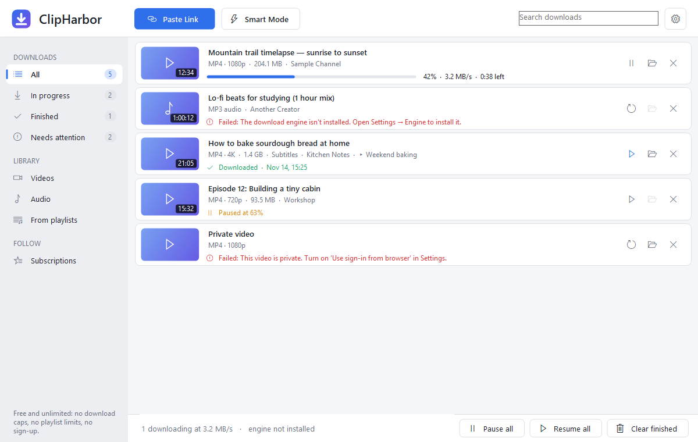
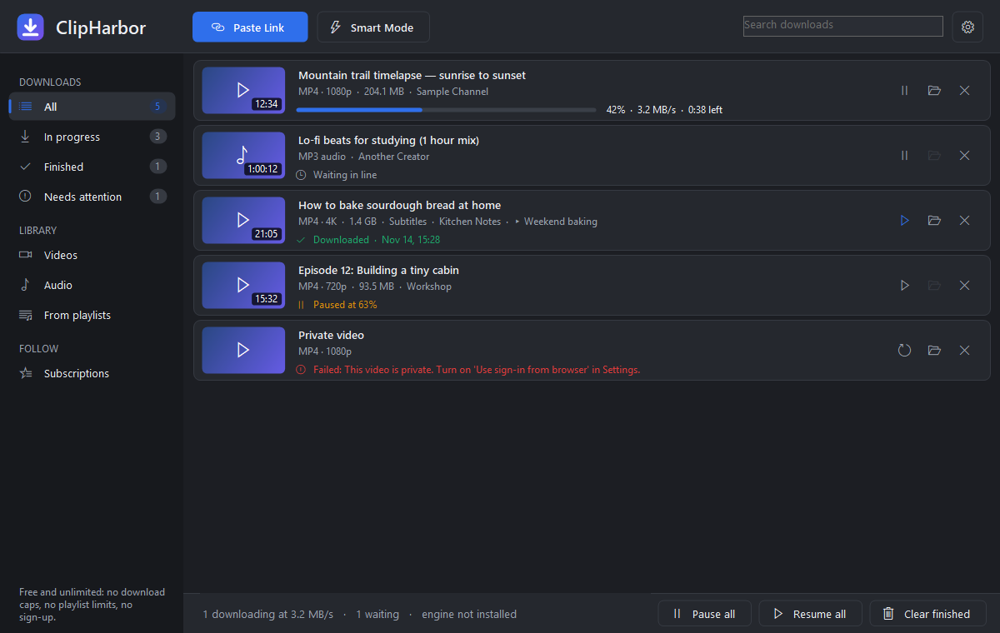

# ClipHarbor

A free, open-source video and audio downloader for Windows. No download caps, no playlist limits, no account.



## Features

- **Paste Link**: copy a link, press the button (or Ctrl+V), choose your options and download. You can also drag links onto the window or pass them on the command line.
- **Video or audio only**: MP4, MKV or WEBM video up to the best quality the site offers (4K/8K included), or MP3, M4A, OPUS, FLAC or WAV audio.
- **Whole playlists and channels**: pick which videos you want, optionally saved into a folder named after the playlist.
- **Subtitles**: choose languages, saved as files or embedded in the video.
- **Smart Mode**: save your choices once and every link afterwards downloads in one click.
- **Subscriptions**: follow a channel or playlist and new videos download automatically.
- **Download list**: progress, speed and time left. Pause, resume, retry, open the file or show it in its folder. You can search and filter the list.
- **Settings**: light, dark or system look, how many downloads run at once, speed limit, proxy, file-name template, browser sign-in for private or age-restricted videos, and embedded cover art and metadata.



## Download engine

ClipHarbor downloads from video sites with two free, open-source tools that are **not included** in this repository:

- [yt-dlp](https://github.com/yt-dlp/yt-dlp) (Unlicense), which reads and downloads from video sites
- [FFmpeg](https://ffmpeg.org/) (LGPL/GPL, builds from [yt-dlp/FFmpeg-Builds](https://github.com/yt-dlp/FFmpeg-Builds)), which joins high-quality video and audio and converts formats

The first time you run ClipHarbor, press **Install engine**. The app then downloads both tools into `%LOCALAPPDATA%\ClipHarbor\tools` (about 140 MB). If `yt-dlp.exe` and `ffmpeg.exe` are already on your `PATH`, or you point to them in Settings, ClipHarbor uses those instead. Direct links to media files (for example `.mp4` or `.mp3`) work without the engine.

## Building

You need Windows and the free [.NET 10 SDK](https://dotnet.microsoft.com/download).

```powershell
dotnet build -c Release
dotnet run -c Release
```

To make a single `.exe` that runs without .NET installed:

```powershell
dotnet publish -c Release -r win-x64 --self-contained true -p:PublishSingleFile=true -o publish
```

Each push also builds automatically on GitHub Actions (see `.github/workflows/build.yml`), and the finished program can be downloaded from the run's artifacts.

### Screenshot option

`ClipHarbor.exe --screenshot out.png` starts the app without taking focus, draws about 120 frames, saves a picture of the window and exits. Automated checks use this option.

## Where your data is kept

Your download list, subscriptions and settings are saved in `%APPDATA%\ClipHarbor\state.json`. By default, downloads go to `Videos\ClipHarbor`.

## Download responsibly

Only download content you have the right to download. Respect copyright and each website's terms of service. ClipHarbor is an independent project. It is not affiliated with or endorsed by any video website or any other download software.

## License

[MIT](LICENSE). The download tools named above have their own licenses.
